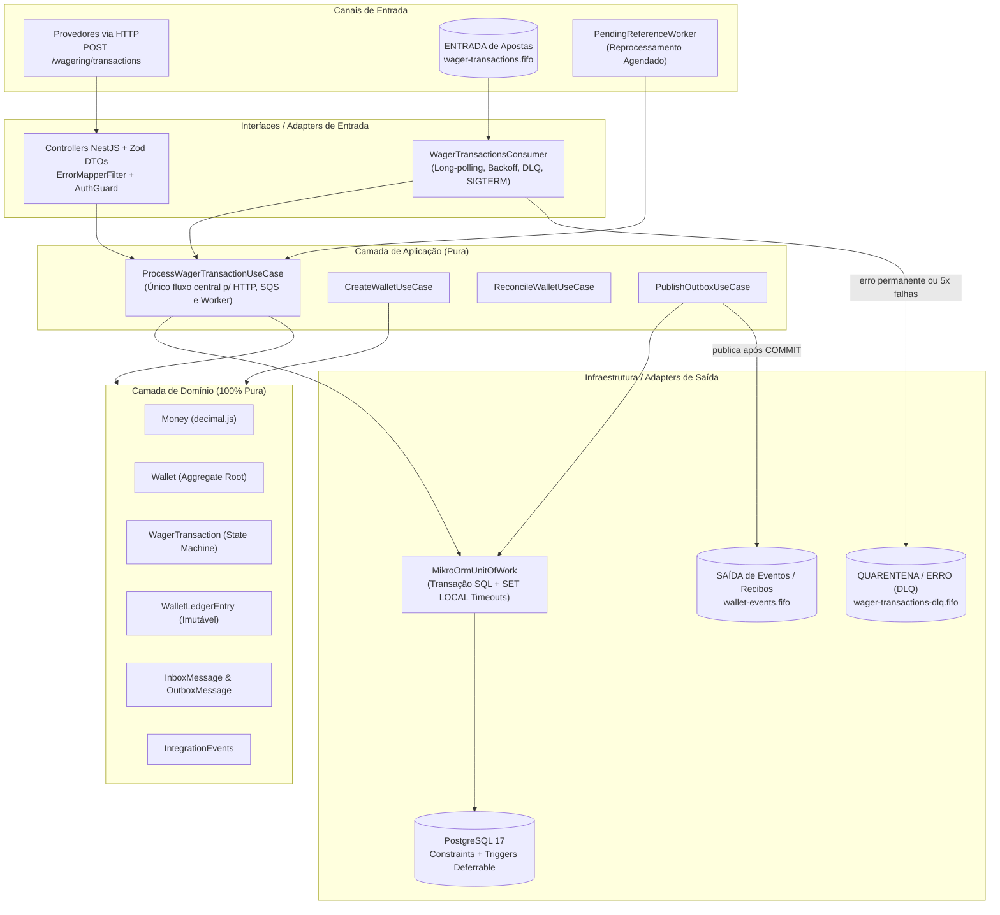
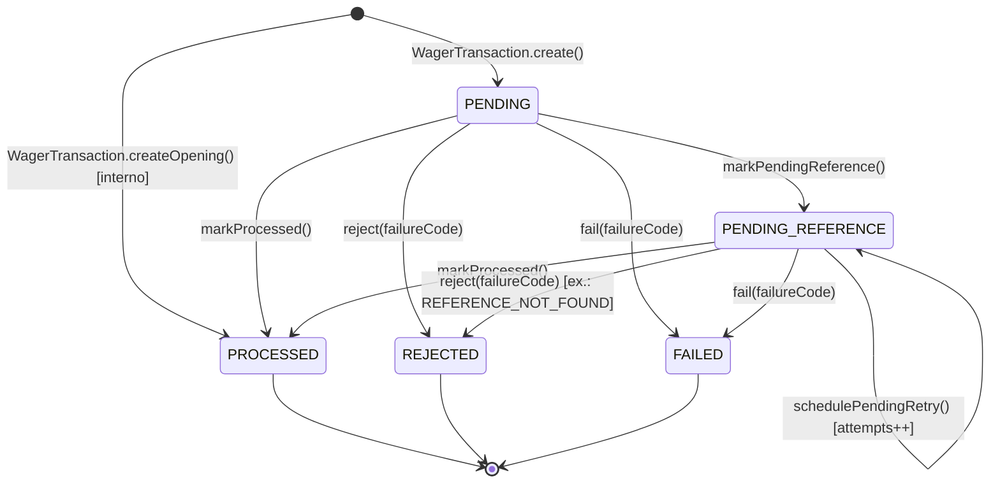

# ARCHITECTURE — Distributed Wagering Processor

## 0. Resumo Executivo Didático (Em Bom Português)

Antes de entrar nos detalhes formais de banco, locks e triggers, vale entender **por que** a arquitetura tem cada peça:

- **Carteira (`Wallet`)**: é a conta do jogador em uma moeda (`1 playerId + currency = 1 wallet`). O sistema proíbe saldo negativo e usa exclusivamente aritmética decimal exata (`decimal.js` + `NUMERIC(20,2)`).
- **Caderno à caneta (`wallet_ledger_entries`)**: toda movimentação de saldo (`OPENING`, `BET`, `WIN`, `REFUND`, `ROLLBACK`) grava uma linha imutável de extrato com `balance_before`, `amount` e `balance_after`. No PostgreSQL, um *trigger* impede qualquer `UPDATE` ou `DELETE`.
- **Etiqueta única (`Idempotency-Key` + `payloadHash` + `inbox_messages`)**: redes distribuídas entregam mensagens repetidas (*at-least-once*). O banco guarda a chave da operação e o hash canônico do payload; repetições idênticas devolvem o resultado original sem alterar o saldo, e reutilizações com payload diferente geram `409 Conflict`.
- **Cadeado por carteira (`SELECT ... FOR UPDATE`)**: se duas requisições para a **mesma** carteira chegarem no mesmo milissegundo em instâncias diferentes, o PostgreSQL serializa uma após a outra. Carteiras diferentes rodam 100% em paralelo.
- **Gaveta de avisos (`outbox_messages` = Transactional Outbox)**: o sistema nunca publica um evento na fila antes do `COMMIT` SQL. Primeiro grava dinheiro + ledger + evento na mesma transação; só depois um worker em background lê os eventos confirmados e publica no SQS.

### Fluxo HTTP vs. Fluxo SQS (convergindo no mesmo Use Case)

1. **Canal HTTP (`POST /wagering/transactions`)**: o provedor chama a API síncrona com `Idempotency-Key` → `WageringController` valida com Zod (`schemas.ts`) → chama `ProcessWagerTransactionUseCase` → responde `201` (processada), `200` (replay), `202` (`PENDING_REFERENCE`), `422` (rejeição de negócio), `409` (conflito) ou `503` (erro transitório com `Retry-After`).
2. **Canal SQS (`wager-transactions.fifo`)**: o provedor envia um envelope `WagerTransactionRequested` → `WagerTransactionsConsumer` valida o envelope e chama **o mesmo** `ProcessWagerTransactionUseCase` (com `inbox: { consumerName, messageId }`) → só executa `DeleteMessage` (ack) **após o `COMMIT`**.
3. **Resolução de pendências (`PendingReferenceWorker`)**: quando um `REFUND` ou `ROLLBACK` (ou `WIN` referenciado) chega antes da `BET`, ele é salvo em `PENDING_REFERENCE` e reprocessado pelo worker também via **o mesmo** `ProcessWagerTransactionUseCase`.

### As 3 Filas SQS FIFO e Seus Papéis

| Fila | Papel | Quem escreve | Quem lê / O que acontece |
|---|---|---|---|
| **`wager-transactions.fifo`** | **ENTRADA** de pedidos de aposta | Provedores de jogo externos | `WagerTransactionsConsumer` lê e processa no PostgreSQL. Só apaga após o `COMMIT`. |
| **`wager-transactions-dlq.fifo`** | **QUARENTENA / ERRO (DLQ)** | SQS (`RedrivePolicy` após 5 falhas) ou Consumer (erro permanente imediato) | Isola mensagens inválidas/envenenadas com atributo `failureReason` para não travar a fila de entrada. `DlqMetricsWorker` monitora a profundidade (`wagering_dlq_depth`). |
| **`wallet-events.fifo`** | **SAÍDA** de eventos / recibos | `OutboxPublisherWorker` (`SqsEventPublisher`) após `COMMIT` | Sistemas downstream do cassino consomem eventos de negócio (`WagerTransactionProcessed`, `WagerTransactionRejected`, `WagerTransactionPendingReference`, `WalletBalanceChanged`). |

### Papel de Cada Camada e Principais Arquivos

| Camada | Responsabilidade | Arquivos-chave |
|---|---|---|
| **Domain (`src/domain/`)** | Regras financeiras puras, invariantes, máquina de estados, eventos e erros (sem Nest/ORM/AWS) | `money/money.ts`, `wallet/wallet.ts`, `wager/wager-transaction.ts`, `wager/failure-code.ts`, `ledger/wallet-ledger-entry.ts`, `messaging/inbox-message.ts`, `messaging/outbox-message.ts`, `events/*.ts`, `errors.ts` |
| **Application (`src/application/`)** | Casos de uso, queries, hash canônico, cursor opaco e contratos (`ports`) | `use-cases/process-wager-transaction.ts`, `create-wallet.ts`, `reconcile-wallet.ts`, `publish-outbox.ts`, `resolve-pending-references.ts`, `queries/*.ts`, `payload-hash.ts`, `cursor.ts`, `ports/index.ts` |
| **Infrastructure (`src/infrastructure/`)** | Implementações reais: PostgreSQL/MikroORM, SQS, workers, config, observabilidade e fault injection | `persistence/migrations/Migration20260729000001_InitialSchema.ts`, `persistence/unit-of-work.ts`, `persistence/repositories/*.ts`, `persistence/schemas/*.ts`, `persistence/mappers/index.ts`, `messaging/sqs-client.ts`, `wager-transactions.consumer.ts`, `sqs-event-publisher.ts`, `workers/*.ts`, `observability/*.ts` |
| **Interfaces (`src/interfaces/http/`)** | Transporte HTTP NestJS, validação Zod, correlação, auth guard e tradução de erros | `controllers/*.ts`, `dto/schemas.ts`, `error-mapper.filter.ts`, `auth.guard.ts`, `correlation.middleware.ts` |
| **Bootstrap (`src/`)** | Composição de dependências e lifecycle/shutdown hooks | `app.module.ts`, `main.ts` |
| **Testes (`test/`)** | Unidade, integração real (PG + LocalStack), concorrência multi-processo/crashes e carga | `test/unit/*.test.ts`, `test/integration/*.test.ts`, `test/concurrency/*.test.ts`, `test/helpers/*.ts`, `test/load/load-test.ts` |

---

## 1. Visão Geral e Arquitetura Hexagonal

O serviço foi projetado segundo **Domain-Driven Design (DDD)** e **Arquitetura Hexagonal (Ports & Adapters)** para garantir que todas as invariantes financeiras sejam preservadas tanto nas entidades de domínio quanto estruturalmente no banco de dados PostgreSQL, mesmo sob entregas duplicadas (*at-least-once*), fora de ordem, falhas abruptas de processos e concorrência entre múltiplas instâncias.



### Boundaries Estritos
- `src/domain/`: **zero** dependências de NestJS, MikroORM ou AWS SDK. Contém apenas regras de negócio, máquinas de estado, aritmética monetária (`decimal.js`) e invariantes encapsuladas com construtores `private` + factories estáticas (`create`, `from`, `open`, `rehydrate`).
- `src/application/`: depende exclusivamente de `src/domain/` e das interfaces em `src/application/ports/`. O `ProcessWagerTransactionUseCase` é o **único** ponto de execução financeira, compartilhado pela API HTTP, pelo consumidor SQS e pelo worker de referências pendentes.
- `src/infrastructure/` e `src/interfaces/`: implementam as portas de persistência (MikroORM + PostgreSQL), mensageria (`@aws-sdk/client-sqs`), workers em background, observabilidade (`pino` + `prom-client`) e transporte HTTP (NestJS).

---

## 2. Escolha do ORM, Mapeamento de Entidades e `Money`

### 2.1 Por que MikroORM 6 + `EntitySchema` Desacoplado
Escolhemos **MikroORM 6** (`@mikro-orm/postgresql`) conforme recomendação preferencial do desafio, utilizando **`EntitySchema`** sobre registros de persistência (`WalletRecord`, `WagerTransactionRecord`, etc.) combinados com **Mappers explícitos** (`WalletMapper.toDomain` -> `Wallet.rehydrate`).

**Justificativas:**
1. **Domínio 100% limpo**: as classes de domínio (`Wallet`, `WagerTransaction`, `WalletLedgerEntry`, `Money`) não carregam decorators de ORM nem precisam de propriedades mutáveis públicas para satisfazer proxies de hidratação.
2. **Compatibilidade determinística com Bun**: evita armadilhas de `emitDecoratorMetadata` em tipos complexos ou value objects aninhados.
3. **Controle explícito de locks e transações**: usamos `em.fork({ clear: true }).transactional(...)` no `MikroOrmUnitOfWork`, combinando `LockMode.PESSIMISTIC_WRITE` (`SELECT ... FOR UPDATE`) e `LockMode.PESSIMISTIC_READ` (`SELECT ... FOR SHARE`) com SQL parametrizado explícito nos `INSERT`/`UPDATE`.

### 2.2 Representação e Persistência de `Money`
- **Proibição absoluta de `number` / IEEE-754**: valores monetários nunca passam por `number`, `parseFloat` ou `Number()`.
- **Domínio**: `Money` encapsula uma instância imutável de `Decimal` (`decimal.js`) e um código de moeda ISO-4217 (`^[A-Z]{3}$`).
- **Contratos de Entrada/Saída (`MoneyProps`)**: sempre string decimal com escala fixa de 2 casas (`"25.00"`). A factory `Money.from()` valida a expressão regular `/^\d+(\.\d{1,2})?$/`, rejeitando `NaN`, `Infinity`, notação científica (`1e5`), strings vazias, espaços, mais de 2 casas decimais e números negativos.
- **Banco de Dados**: colunas `NUMERIC(20, 2)` + `CHAR(3)`, lidas pelo driver PostgreSQL/MikroORM como `string` e reconstruídas via `Money.fromPersistence(amountStr, currency)`.

---

## 3. Estratégia Transacional, Concorrência e Invariantes no Banco

### 3.1 Unidade de Concorrência = `walletId`
Cada operação financeira executa dentro de uma única transação SQL `READ COMMITTED` gerenciada pelo `MikroOrmUnitOfWork`, que aplica no início da transação:
```sql
SET LOCAL lock_timeout = '5000ms';
SET LOCAL statement_timeout = '10000ms';
```

A estratégia adotada combina **três camadas de proteção (Defesa em Profundidade)**:

1. **Pessimistic Write Lock por Wallet (`SELECT ... FROM wallets WHERE id = ? FOR UPDATE`)**:
   - Adquirido logo após o registro de inbox (quando SQS) e **antes** da verificação de idempotência, validação de referência e cálculo de saldo.
   - Serializa todas as operações concorrentes da mesma wallet sem bloquear wallets distintas.
2. **Checagem de Versão no Update (`UPDATE wallets SET balance = ?, version = ?, updated_at = ? WHERE id = ? AND version = ?`)**:
   - `wallet.version` inicia em `1` e incrementa **somente quando o saldo muda** (transações `LOSS` e `REJECTED` não incrementam a versão da wallet).
   - Se `affectedRows !== 1`, lança `OptimisticConcurrencyError`.
3. **Constraints e Triggers no Schema do PostgreSQL**:
   - `CHECK (balance >= 0)` e `CHECK (version >= 1)` na tabela `wallets`.
   - `CONSTRAINT uq_wallet_player_currency UNIQUE (player_id, currency)`.
   - `CONSTRAINT uq_ledger_tx_wallet UNIQUE (transaction_id, wallet_id)` e `CONSTRAINT uq_ledger_wallet_version UNIQUE (wallet_id, wallet_version)`.
   - `CONSTRAINT ck_ledger_arithmetic CHECK ((direction = 'CREDIT' AND balance_after = balance_before + amount) OR (direction = 'DEBIT' AND balance_after = balance_before - amount))`.
   - **Trigger Append-Only (`trg_ledger_no_update`)**: bloqueia qualquer `UPDATE` ou `DELETE` em `wallet_ledger_entries`.
   - **Trigger de Imutabilidade de Transação Terminal (`trg_wtx_terminal`)**: bloqueia qualquer transição a partir de `PROCESSED`, `REJECTED` ou `FAILED`, bem como qualquer alteração em colunas de negócio (`amount`, `currency`, `kind`, `wallet_id`, `player_id`, `idempotency_key`, `payload_hash`, `provider_id`, `external_transaction_id`).
   - **Constraint Trigger Deferrable (`trg_wallet_ledger_consistency`)**: executado `AFTER INSERT OR UPDATE ON wallets DEFERRABLE INITIALLY DEFERRED` (avaliado imediatamente antes do `COMMIT` via `SET CONSTRAINTS ALL IMMEDIATE`). Garante no próprio banco que nenhum saldo `<> 0` ou `version > 1` possa ser confirmado sem que exista a linha correspondente em `wallet_ledger_entries` com `wallet_version = NEW.version` e `balance_after = NEW.balance`.

### 3.2 Trade-offs: Pessimistic Locking vs Optimistic Locking vs Conditional Atomic Update
| Estratégia | Vantagens | Desvantagens no Contexto de Wagering |
|---|---|---|
| **Pessimistic Locking (`SELECT ... FOR UPDATE`) — Adotada** | Serializa a leitura do saldo, a verificação de idempotência, a checagem de dupla reversão e o cálculo de `balance_before`/`balance_after`/`wallet_version` do ledger em uma única ida ao banco, sem abortar transações legítimas em *hot wallets*. | Mantém lock de linha durante a transação (~1–5ms). Mitigado por transações curtas (zero I/O de rede externo dentro da tx) e `lock_timeout = 5s`. |
| **Optimistic Locking Puro (`WHERE version = ?`)** | Sem lock de leitura inicial. | Sob contenção na mesma wallet (ex.: 50 retries simultâneos ou rajada de eventos da mesma rodada), gera tempestade de `rollback + retry`, desperdiçando conexões e CPU do banco. |
| **Update Atômico Condicional (`SET balance = balance - :amt WHERE balance >= :amt`)** | Muito rápido para atualizar apenas a coluna `balance`. | Como exigimos gravar `balance_before` e `balance_after` exatos no ledger e validar referências antes de debitar, o `UPDATE` atômico sozinho ainda exigiria lock na linha da wallet. |

**Ordem fixa de locks para prevenção de deadlocks:** sempre `wallets` -> `wager_transactions`. Tanto o fluxo HTTP/SQS quanto o `PendingReferenceWorker` respeitam essa ordem.

---

## 4. Idempotência Persistente e Deduplicação

### 4.1 Algoritmo de `payloadHash`
Definido em `src/application/payload-hash.ts`:
1. Extrai exclusivamente o subconjunto de campos de negócio da operação:
   `providerId`, `externalTransactionId`, `playerId`, `walletId`, `roundId`, `gameId`, `kind`, `money: { amount, currency }` (com `amount` normalizado para 2 casas decimais via `Money.from`) e `referenceExternalTransactionId` (se presente).
2. Metadados de transporte (headers HTTP, `X-Correlation-Id`, `messageId` do SQS, `occurredAt`) **não** entram no hash.
3. Serializa em **JSON canônico** ordenando todas as chaves de objetos recursivamente em ordem lexicográfica e omitindo chaves `undefined`.
4. Calcula o digest `SHA-256` em hexadecimal (64 caracteres).

### 4.2 Comportamento em Replay vs Conflito
- **Mesma `Idempotency-Key` + mesmo `payloadHash`**: retorna exatamente o resultado original persistido (`transactionId`, `status`, `failureCode` e o saldo observado no momento da decisão original armazenado em `resulting_balance`), marcando `idempotentReplay: true`.
- **Mesma `Idempotency-Key` + `payloadHash` diferente** (ou mesmo `(providerId, externalTransactionId)` com `Idempotency-Key` diferente): rejeitado com `409 Conflict` (`IDEMPOTENCY_CONFLICT`), sem alterar estado.
- **Inbox Persistente (`inbox_messages`)**: no consumidor SQS, a mensagem é registrada por `(consumer_name, message_id)` na mesma transação SQL que aplica o efeito financeiro. Se a mesma `messageId` for reentregue pelo SQS (ex.: após queda do worker antes do `DeleteMessage`), a deduplicação ocorre no banco e o consumidor apenas confirma o `ack`.

---

## 5. Máquina de Estados e Taxonomia de Códigos de Falha

### 5.1 Máquina de Estados de `WagerTransaction`



`PROCESSED`, `REJECTED` e `FAILED` são estados **terminais**: qualquer tentativa de transição lança `InvalidTransactionStateError` no domínio e é bloqueada pelo trigger `trg_wtx_terminal` no PostgreSQL.

### 5.2 Taxonomia de `failureCode` (Rejeições de Negócio Persistidas)

| `failureCode` | Situação | Ação esperada do Provedor |
|---|---|---|
| `INSUFFICIENT_FUNDS` | `BET` com valor maior que o saldo disponível na wallet | Não reenviar a mesma aposta; informar jogador |
| `REVERSAL_INSUFFICIENT_FUNDS` | `ROLLBACK` de um `WIN` ou `REFUND` cujo saldo já foi consumido pelo jogador (produziria saldo negativo) | Escalar operacionalmente / auditoria (distinto de aposta sem saldo — regra 7.9) |
| `CURRENCY_MISMATCH` | Moeda da transação difere da moeda da wallet | Corrigir payload com nova transação |
| `PLAYER_WALLET_MISMATCH` | `playerId` informado não é o titular da `walletId` | Corrigir payload |
| `REFERENCE_NOT_FOUND` | `PENDING_REFERENCE` atingiu o limite de tentativas/TTL sem que a transação referenciada chegasse | Enviar a transação referenciada primeiro ou auditar |
| `REFERENCE_MISMATCH` | Transação referenciada pertence a outro provider, player, wallet, moeda ou `roundId` | Corrigir payload |
| `REFERENCE_INVALID_KIND` | `REFUND` apontando para algo `!= BET`, `ROLLBACK` apontando para `LOSS`/`OPENING`, ou `WIN` apontando para `!= BET` | Corrigir payload |
| `REFERENCE_AMOUNT_MISMATCH` | Valor do `REFUND`/`ROLLBACK` difere do valor da transação referenciada | Corrigir payload |
| `REFERENCE_NOT_PROCESSED` | Transação referenciada terminou em `REJECTED` ou `FAILED` | Desistir da reversão |
| `REFERENCE_ALREADY_REVERSED` | Transação referenciada já foi revertida anteriormente | Nenhuma ação necessária (reversão já efetuada) |
| `PROCESSING_FAILED` | Falha permanente auditável (`FAILED`) | Contatar suporte |

### 5.3 Mapeamento de Status HTTP (`ErrorMapperFilter`)

| Situação | HTTP Status | Semântica para o Provedor |
|---|---|---|
| Transação processada (1ª vez) | `201 Created` | Aplicada com sucesso (`idempotentReplay: false`) |
| Replay idempotente de transação `PROCESSED` | `200 OK` | Já aplicada anteriormente (`idempotentReplay: true`, saldo histórico original) |
| Referência ainda ausente (`PENDING_REFERENCE`) | `202 Accepted` | Aceita e aguardando chegada da transação referenciada |
| Rejeição por regra de negócio (`REJECTED`, 1ª vez ou replay) | `422 Unprocessable Entity` | Decisão terminal de negócio com `failureCode`; não adianta reenviar igual |
| Payload inválido / header `Idempotency-Key` ausente / `OPENING` externo | `400 Bad Request` | Erro sintático ou de contrato; corrigir requisição |
| Wallet ou transação não encontrada | `404 Not Found` | Recurso inexistente |
| Conflito de idempotência ou wallet duplicada p/ `(playerId, currency)` | `409 Conflict` | Colisão de chave de idempotência com payload divergente ou recurso já existente |
| Falha transitória de banco / lock timeout / infraestrutura | `503 Service Unavailable` | Inclui header `Retry-After: 1`; seguro reenviar com a mesma `Idempotency-Key` |

---

## 6. Transactional Outbox, Referências Fora de Ordem e SQS

### 6.1 Transactional Outbox (`OutboxPublisherWorker`)
1. **Atomicidade**: os eventos `WagerTransactionProcessed`, `WagerTransactionRejected`, `WagerTransactionPendingReference` e `WalletBalanceChanged` são inseridos na tabela `outbox_messages` na **mesma transação SQL** da mudança financeira. Nenhuma chamada ao SQS ocorre dentro do use case.
2. **Concorrência entre múltiplos publishers**: cada instância executa um lease atômico via:
   ```sql
   UPDATE outbox_messages
   SET locked_until = now() + interval '30 seconds', locked_by = :instanceId
   WHERE id IN (
     SELECT id FROM outbox_messages
     WHERE published_at IS NULL
       AND next_attempt_at <= now()
       AND (locked_until IS NULL OR locked_until < now())
     ORDER BY seq ASC
     LIMIT 50
     FOR UPDATE SKIP LOCKED
   )
   RETURNING *;
   ```
3. **Recuperação após falha**: se uma instância morrer após adquirir o lease e antes de gravar `published_at`, o lease (`locked_until`) expira e outra instância republica o evento na fila `wallet-events.fifo` usando `MessageGroupId = aggregateId` (walletId) e `MessageDeduplicationId = eventId`. Consumidores downstream deduplicam pelo `eventId` do envelope `IntegrationEvent`.

### 6.2 Resolução de Referências Fora de Ordem (`PendingReferenceWorker`)
- Quando um `REFUND` ou `ROLLBACK` (ou `WIN` com `referenceExternalTransactionId`) chega antes da operação referenciada (ou enquanto a operação referenciada ainda está pendente), a transação é persistida como `PENDING_REFERENCE` e o evento `WagerTransactionPendingReference` é enfileirado na outbox.
- O `PendingReferenceWorker` reivindica periodicamente transações vencidas usando `FOR UPDATE SKIP LOCKED` e invoca o `ProcessWagerTransactionUseCase` em modo `WORKER`.
- **Backoff e Limite/TTL justificados**: utiliza backoff exponencial (`min(base * 2^(attempts-1), 60s)`) com limite de **10 tentativas ou TTL de 15 minutos** desde `created_at` (configuráveis via env). Em plataformas de iGaming, retentativas de provedores para uma `BET` atrasada ocorrem em segundos ou poucos minutos; 15 minutos absorvem *retry storms* de rede sem manter transações financeiras pendentes indefinidamente. Ao atingir o limite, a transação transiciona para `REJECTED` com `failureCode = REFERENCE_NOT_FOUND` e publica `WagerTransactionRejected`.

### 6.3 Consumidor SQS, Classificação de Erros e Graceful Shutdown
- **Mesmo Use Case**: o `WagerTransactionsConsumer` chama `ProcessWagerTransactionUseCase` passando `inbox: { consumerName: 'wager-transactions-consumer', messageId }`.
- **Ack somente pós-commit**: `DeleteMessage` só é executado após o commit da transação SQL.
- **Classificação de erros**:
  - *Negócio (`PROCESSED`, `REJECTED`, `PENDING_REFERENCE`, replay/duplicata)*: commitados no banco -> `DeleteMessage` (ack).
  - *Transitórios (`TransientInfrastructureError`, timeouts/deadlocks)*: incrementa métrica de retry e agenda nova tentativa via `ChangeMessageVisibility` com backoff exponencial até `SQS_MAX_RECEIVE_COUNT` (default 5), quando então é encaminhada para `wager-transactions-dlq.fifo` com `failureReason = MAX_RECEIVE_COUNT_EXCEEDED`.
  - *Permanentes (JSON malformado, envelope inválido, `kind = OPENING`, `INBOX_PAYLOAD_CONFLICT`, `IDEMPOTENCY_CONFLICT`, `WALLET_NOT_FOUND`)*: enviados imediatamente para `wager-transactions-dlq.fifo` com atributo `failureReason` e removidos da fila principal.
- **SIGTERM**: interrompe o long-polling via `AbortController`, aguarda a conclusão das mensagens em processamento até `SHUTDOWN_GRACE_MS` (20s) e devolve imediatamente a visibilidade (`VisibilityTimeout = 0`) de quaisquer mensagens recebidas no lote que ainda não haviam iniciado processamento.

---

## 7. Interpretações Adotadas e Decisões Documentadas

1. **Unicidade de Reversão (`REFUND` / `ROLLBACK`)**:
   - O enunciado (§7, regra 4) afirma que *"uma referência não pode ser revertida duas vezes pelo mesmo tipo de operação"* e na tabela (§7) que `REFUND` e `ROLLBACK` revertem uma transação `PROCESSED` *"uma única vez"*. Adotamos a interpretação mais segura financeiramente: **uma transação `BET` só pode ter no máximo uma reversão `PROCESSED` no total** (seja `REFUND` ou `ROLLBACK`), garantida tanto no domínio quanto pelo índice parcial único `uq_wtx_single_reversal ON wager_transactions (reference_transaction_id) WHERE kind IN ('REFUND','ROLLBACK') AND status = 'PROCESSED'`. Isso impede que um provedor envie `REFUND` e depois `ROLLBACK` para a mesma `BET` e duplique o crédito. Já o `ROLLBACK` de um `REFUND` (que referencia o ID do próprio `REFUND` para estornar o crédito) é permitido normalmente.
2. **`WIN` com Referência Opcional**:
   - Conforme §7 (*"WIN pode referenciar a BET da mesma rodada"*), `referenceExternalTransactionId` é opcional em `WIN`. Quando informado, passa pelas mesmas validações de referência (mesmo provider, player, wallet, moeda, rodada e `kind = BET` em estado `PROCESSED`; se a `BET` ainda não chegou, aguarda em `PENDING_REFERENCE`).
3. **`WALLET_NOT_FOUND` (404)**:
   - Se `walletId` não existe na tabela `wallets`, a operação retorna `404 WALLET_NOT_FOUND` sem persistir linha em `wager_transactions`, preservando a integridade referencial da FK `wallet_id REFERENCES wallets(id)`.
4. **LocalStack 3.8**:
   - Fixamos a imagem `localstack/localstack:3.8` no `docker-compose.yml` para garantir execução local de SQS FIFO 100% livre de exigência de `LOCALSTACK_AUTH_TOKEN`.

---

## 8. Autenticação (Decisão e Desenho de Integração com IdP)

Conforme permitido na seção 2 do enunciado, **optamos por não subir um container de IdP** para concentrar o foco em correção financeira, concorrência e resiliência, deixando o ponto de extensão explícito no código:
- **Ponto de extensão**: porta `ProviderIdentityPort` (`src/application/ports/index.ts`) injetada no `AuthGuard` global (`src/interfaces/http/auth.guard.ts`), com implementação default `NoOpProviderIdentityAdapter`. Endpoints `/health/*` e `/metrics` são públicos.
- **Desenho de Produção com Keycloak (OIDC Client Credentials)**:
  1. Cada provedor de jogos (`provider-a`, `provider-b`) possui um Confidential Client no Keycloak com *Service Account* habilitada e um Protocol Mapper que injeta a claim customizada `provider_id` no Access Token JWT (assinado com RS256).
  2. O adaptador `KeycloakProviderIdentityAdapter` implementa `ProviderIdentityPort`, validando a assinatura do Bearer Token contra o endpoint JWKS do Keycloak (`/realms/jungle/protocol/openid-connect/certs`, com cache de chaves públicas), além de `iss`, `aud` e `exp`.
  3. O `AuthGuard` anexa `providerIdentity` à requisição e valida que `token.provider_id === body.providerId` (impedindo que um provedor autenticado submeta transações ou consulte dados em nome de outro provedor).

---

## 9. Observabilidade

- **Logs Estruturados (`pino`)**: formato JSON com propagação automática de `correlationId`, `messageId`, `transactionId`, `walletId` e `providerId` via `AsyncLocalStorage` (`src/infrastructure/observability/context.ts`). Campos financeiros e sensíveis (`amount`, `balance`, `playerId`, `payload`) são automaticamente filtrados (*redacted*) no logger.
- **Métricas Prometheus (`GET /metrics`)**:
  - `wagering_transactions_total{status,kind,source}`
  - `wagering_idempotent_replays_total{source}`
  - `wagering_inbox_duplicates_total`
  - `wagering_retries_total{reason}`
  - `wagering_dlq_messages_total{reason}`
  - `wagering_dlq_depth`
  - `wagering_lock_conflicts_total`
  - `wagering_outbox_lag_seconds`
  - `wagering_outbox_published_total{event_type}`
  - `wagering_outbox_publish_failures_total`
  - `wagering_processing_duration_seconds` (histograma por `source`)
  - `wagering_pending_reference_total`
  - `wagering_reconciliation_mismatches_total`
- **Health Checks**: `GET /health/live` (liveness) e `GET /health/ready` (readiness verificando `SELECT 1` no PostgreSQL e `GetQueueUrl` no SQS, retornando `503` caso qualquer dependência esteja indisponível).

---

## 10. Limitações Conhecidas e Próximos Passos

1. **Particionamento de Tabelas de Alto Volume**: em produção com centenas de milhões de apostas, `wallet_ledger_entries`, `wager_transactions` e `outbox_messages` devem ser particionadas por intervalo de tempo (ex.: `pg_partman` mensal/semanal) e as mensagens de outbox/inbox já processadas devem ser expurgadas após a janela de retenção.
2. **Double-Entry Bookkeeping Completo**: atualmente cada wallet possui seu ledger auditável de entradas `CREDIT`/`DEBIT`; uma evolução natural é registrar a contrapartida contábil na conta de clearing de cada `providerId` / `house`.
3. **Notificação Reativa na Outbox (`LISTEN/NOTIFY` ou CDC)**: reduzir ainda mais a latência de publicação da outbox combinando o polling de segurança com `NOTIFY` do PostgreSQL ou Debezium CDC.
